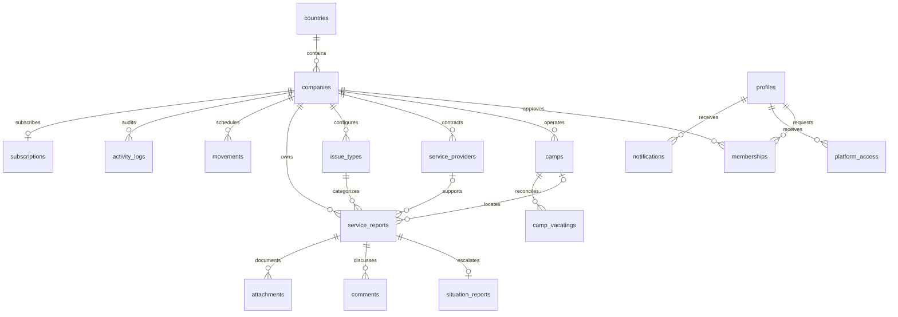

# Database relationships

Company-scoped composite foreign keys prevent an incident from referencing another company's camp, issue type, provider or source report. Row Level Security enforces read/write scope on every application table. The profile table contains identity display details, while Auth owns passwords and verified emails.

Membership and platform-access tables control permissions; client-supplied role fields cannot change access. The project owner bootstraps the first super administrator, then that administrator can provision other privileged accounts. One active/pending company membership is enforced by a partial unique index.

Escalation locks the source incident and inserts/reuses the linked Tool 10 inside a transaction. Unique report numbers use sequences. Triggers preserve incident authorship, enforce transitions, prevent edits after approval/closure, create notifications and record operational changes. Database grants restrict notification updates to `read_at` and prevent users modifying audit records or billing status.

Private Storage object paths follow `company_id/report_id/randomized-filename`. Access requires both an existing report and company authorization. Signed download links expire after 60 seconds.
